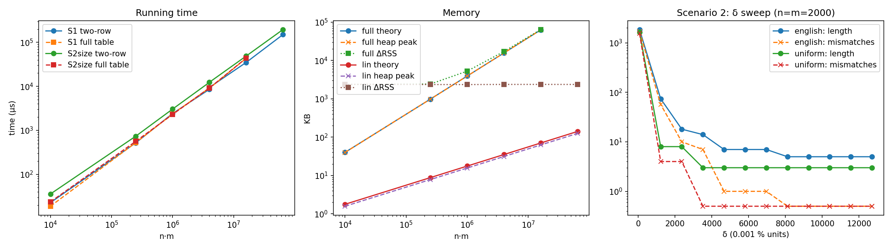
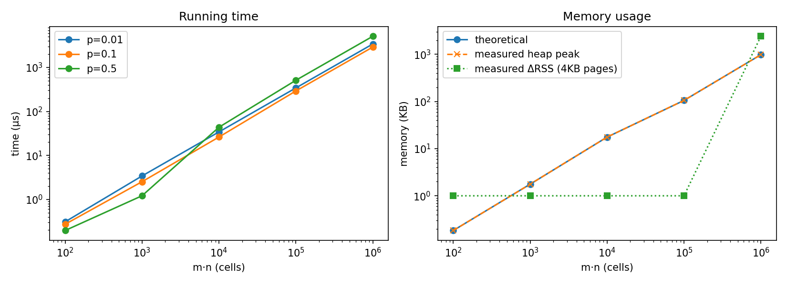

# Assignment 2 Report: Dynamic Programming

**Implementation.** C++17, compiled with `g++ -O2 -std=c++17`. Every algorithm is iterative (no recursion) and uses contiguous arrays (`std::vector`).

**Test machine.** CPU: *[fill in]*, OS: *[fill in]*, compiler: *[fill in]*.

**Files.**

| File | Content |
|---|---|
| `problem1.cpp` | Problem 1: DP solvers, brute-force checker, data generator, experiments |
| `problem2.cpp` | Problem 2: DP solver, prefix-sum verifier, data generator, experiments |
| `plot_p1.py`, `plot_p2.py` | Plotting scripts |
| `results_p1.csv`, `results_p2.csv` | Running-time experiments |
| `mem_p1.csv`, `mem_p2.csv` | Memory experiments (one process per configuration) |

**How to run.**

```bash
g++ -O2 -std=c++17 problem1.cpp -o p1
g++ -O2 -std=c++17 problem2.cpp -o p2
./p1 > results_p1.csv
./p2 > results_p2.csv
./p1 mem 4000 4000 full      # single memory measurement (Problem 1)
./p2 1000 1000 0.1           # single memory measurement (Problem 2)
python plot_p1.py
python plot_p2.py
```

---

## Problem 1: Weighted Approximate Common Substring

### 1.1 Problem formulation

Let X = x<sub>1</sub>…x<sub>n</sub> and Y = y<sub>1</sub>…y<sub>m</sub> be strings over [A–Z]. A candidate solution is a pair of equal-length substrings X[i−L+1..i] and Y[j−L+1..j], compared position by position with no gaps. The per-position score is

```
s(a, b) = w_a      if a = b      (weight of the matched letter)
        = -delta   if a != b     (mismatch penalty)
```

The score of a pair is the sum of its per-position scores, and we want the pair with maximum score. The empty pair (L = 0) scores 0, so the optimum is always ≥ 0.

**Key observation.** Since gaps are not allowed, position k of one substring is always aligned with position k of the other. Every candidate pair therefore lies on a single diagonal (j − i = constant) of the n × m comparison grid. On each diagonal the problem becomes a maximum-sum contiguous subarray problem (Kadane's algorithm), and the DP below solves all n + m − 1 diagonals together. It is the gap-free special case of Smith–Waterman local alignment.

### 1.2 Optimization function

`D[i][j]` is the maximum score over all aligned pairs, including the empty one, whose last characters are x<sub>i</sub> and y<sub>j</sub>, i.e. that **end** at (i, j), for 0 ≤ i ≤ n and 0 ≤ j ≤ m.

### 1.3 Bellman equations

```
D[i][0] = D[0][j] = 0                                  (boundary)
D[i][j] = max( 0,  D[i-1][j-1] + s(x_i, y_j) )         1 <= i <= n, 1 <= j <= m
OPT     = max over all (i, j) of D[i][j]
```

### 1.4 Correctness

**Base case.** If i = 0 or j = 0, only the empty pair ends at (i, j), so D = 0.

**Inductive step.** A pair ending at (i, j) is either empty (score 0) or has length L ≥ 1. A non-empty pair is its last aligned position (x<sub>i</sub>, y<sub>j</sub>), which contributes s(x<sub>i</sub>, y<sub>j</sub>), preceded by a pair of length L − 1 ending at (i−1, j−1) (that prefix may be empty). Its score is therefore (prefix score) + s(x<sub>i</sub>, y<sub>j</sub>). By the induction hypothesis the best prefix ending at (i−1, j−1) scores `D[i-1][j-1]`, so the best non-empty pair scores `D[i-1][j-1] + s(x_i, y_j)`. Comparing with the empty pair gives the recurrence.

**Optimal substructure (cut-and-paste).** Suppose the prefix of an optimal pair ending at (i, j) were not optimal among pairs ending at (i−1, j−1). Replacing it with a better prefix would give a pair ending at (i, j) with a higher score, which is a contradiction.

**Global optimum.** Every pair ends at some cell, so the maximum of D over all cells is the optimal score. The `max(0, ·)` term means "start a new substring here": a prefix with negative total score is never worth keeping.

**Example (handout).** For "CAABC" in X and "CAACC" in Y, the scores along the diagonal are w<sub>C</sub>, w<sub>A</sub>, w<sub>A</sub>, −δ, w<sub>C</sub>, which sum to 2w<sub>C</sub> + 2w<sub>A</sub> − δ as required. With the Scenario 2 weights and δ = 5814, the program computes 2·2782 + 2·8167 − 5814 = 16084.

### 1.5 Extracting the optimal solution

During the fill we record the argmax cell `(i*, j*)`. Ties are broken by the first cell reached in row-major order. We then walk back along the diagonal `(i*, j*), (i*-1, j*-1), ...` while D > 0 and count the steps as L. The answer is `X[i*-L+1 .. i*]` and `Y[j*-L+1 .. j*]`, with score `D[i*][j*]`.

This works because D > 0 at a cell means its pair extends the pair ending at the previous diagonal cell. The first cell with D = 0 is where the optimal run restarted. If D is 0 because of an exact tie, dropping a zero-score prefix leaves the score unchanged.

**Space-optimized variant.** Along with D, we store the run length `R[i][j] = R[i-1][j-1] + 1` if `D[i][j] > 0`, and 0 otherwise. Only two rows of D and two rows of R are kept, and R at the argmax gives L directly, so no full table is needed for extraction. On every input tested, this variant returned exactly the same solution as the full-table version.

### 1.6 Time and space complexity

**Time: Θ(nm).** There are (n+1)(m+1) cells, each filled in O(1) (one comparison, one addition, one max). Extraction walks at most min(n, m) diagonal steps, so the total is Θ(nm).

**Space.**

| Version | Storage | Complexity |
|---|---|---|
| Full table | (n+1)(m+1) four-byte integers | Θ(nm) |
| Two-row | 4(m+1) four-byte integers | Θ(m), or Θ(min(n, m)) if columns index the shorter string |
| Input strings | n + m bytes | Θ(n + m) |

**Overflow.** The maximum possible score is max w<sub>l</sub> · min(n, m) ≤ 12702 · 8000 ≈ 1.0 × 10<sup>8</sup> < 2<sup>31</sup> − 1. The program checks this bound before each run.

### 1.7 Implementation and validation

The program has three solvers. `solveFull` uses the full table with traceback. `solveLinear` uses two rows plus run lengths. `bruteForce` enumerates every start pair and length in O(nm · min(n, m)) time and serves as an independent check.

We validated the implementation in three ways:

1. **Random cross-check.** The two DP solvers were compared with brute force on 500 random cases with n, m ≤ 60. Half of the cases used a 3-letter alphabet so that long runs containing mismatches appear often. The cases covered both scenarios and random δ values, and all 500 passed.
2. **Per-experiment checks.** In every experiment the score of the extracted substrings was recomputed from scratch (column `score_ok`), and the two solvers' outputs were compared (column `full_eq_lin`). Every check returned "yes".
3. **Handout example.** In Scenario 1 the optimum for the handout strings is "BCAA" (positions 2 and 3, score 4). "BCAA" also occurs at position 6 of X with the same score, so the optimum is not unique, and the program reports the first one found. In Scenario 2 with δ = 5814, the optimum "AABCAA" / "ABBCAA" (score 22961) contains one mismatch: a long high-weight run can be worth paying the penalty for.

### 1.8 Experimental setup

**Scenario 1.** w<sub>l</sub> = 1 for every letter and δ = 10. A mismatch only pays off if it links ten extra matches, so the optimum is essentially the longest exact common substring.

**Scenario 2.** w<sub>l</sub> is proportional to the relative frequency of the letter in English. We used the standard frequency table (Lewand, *Cryptological Mathematics*), in units of 0.001%:

| Letter | A | B | C | D | E | F | G | H | I | J | K | L | M |
|---|---|---|---|---|---|---|---|---|---|---|---|---|---|
| Weight | 8167 | 1492 | 2782 | 4253 | 12702 | 2228 | 2015 | 6094 | 6966 | 153 | 772 | 4025 | 2406 |

| Letter | N | O | P | Q | R | S | T | U | V | W | X | Y | Z |
|---|---|---|---|---|---|---|---|---|---|---|---|---|---|
| Weight | 6749 | 7507 | 1929 | 95 | 5987 | 6327 | 9056 | 2758 | 978 | 2360 | 150 | 1974 | 74 |

Integer weights keep every score exact. The proportionality constant does not matter: multiplying all weights and δ by the same factor multiplies every score by that factor, so only the ratio δ/w affects the optimum. The ten intermediate penalties are equally spaced between w<sub>min</sub> = 74 (Z) and w<sub>max</sub> = 12702 (E):

```
delta_t = 74 + t * (12702 - 74) / 11 = 74 + 1148 t,     t = 1..10
delta  in {1222, 2370, 3518, 4666, 5814, 6962, 8110, 9258, 10406, 11554}
```

The endpoints δ = 74 and δ = 12702 (t = 0 and t = 11) were run as well for reference.

**Synthetic data.** We generated random strings from two letter distributions: uniform over the 26 letters, and the English-frequency distribution above. Sizes were n = m ∈ {100, 500, 1000, 2000, 4000, 8000}, plus an unequal-length case of 1000 × 4000. A fixed seed (20261103) makes every run reproducible. The full table was used only up to 4000 × 4000 (64 MB); the 8000 × 8000 case ran with the two-row version only.

**Measurement.** Running time was measured with `std::chrono::steady_clock`: one warm-up run, then repetitions until at least 200 ms and at least 3 repetitions had elapsed, reporting the average per run. Memory was measured in two ways, each configuration in a separate process:

- **Heap peak:** the exact number of bytes allocated by the solver, obtained by counting every `operator new` call.
- **ΔRSS:** the resident set size reported by the operating system (`/proc/self/statm`, `getrusage`).

### 1.9 Results

**Table 1.1: Running time (Scenario 1, English distribution).**

| n × m | Cells | Full table (µs) | Two-row (µs) | Two-row ns/cell |
|---|---|---|---|---|
| 100 × 100 | 10<sup>4</sup> | 18.80 | 22.72 | 2.27 |
| 500 × 500 | 2.5·10<sup>5</sup> | 527.22 | 519.56 | 2.08 |
| 1000 × 1000 | 10<sup>6</sup> | 2353.20 | 2415.01 | 2.42 |
| 2000 × 2000 | 4·10<sup>6</sup> | 9132.71 | 8558.43 | 2.14 |
| 1000 × 4000 | 4·10<sup>6</sup> | 9019.38 | 9455.98 | 2.36 |
| 4000 × 4000 | 1.6·10<sup>7</sup> | 43435.57 | 34973.76 | 2.19 |
| 8000 × 8000 | 6.4·10<sup>7</sup> | — | 150102.80 | 2.35 |

**Table 1.2: Memory (bytes, except ΔRSS in KB).**

| n × m | Theory, full | Heap peak, full | Theory, two-row | Heap peak, two-row | ΔRSS, full (KB) |
|---|---|---|---|---|---|
| 100 × 100 | 41,004 | 40,804 | 1,816 | 1,616 | (start-up peak) |
| 500 × 500 | 1,005,004 | 1,004,004 | 9,016 | 8,016 | (start-up peak) |
| 1000 × 1000 | 4,010,004 | 4,008,004 | 18,016 | 16,016 | 5,256 |
| 2000 × 2000 | 16,020,004 | 16,016,004 | 36,016 | 32,016 | 17,064 |
| 4000 × 4000 | 64,040,004 | 64,032,004 | 72,016 | 64,016 | 63,800 |
| 8000 × 8000 | — | — | 144,016 | 128,016 | — |

The theoretical columns include the two input strings (n + m bytes). The heap-peak columns count only the DP arrays.

**Table 1.3: Scenario 2 δ sweep (n = m = 2000, English distribution).**

| t | δ | Length | Mismatches | Score | Optimal pair |
|---|---|---|---|---|---|
| 0 | 74 | 1852 | 1702 | 1,155,080 | (nearly the whole diagonal) |
| 1 | 1222 | 74 | 57 | 105,713 | (74 characters) |
| 2 | 2370 | 18 | 10 | 63,360 | ESEOGAEBEATHAERRET / ESECLRESEAANFEGHIT |
| 3 | 3518 | 14 | 7 | 53,378 | ESEOGAEBEATHAE / ESECLRESEAANFE |
| 4–6 | 4666–6962 | 7 | 1 | 51,651 → 49,355 | EEYTMEN / EETTMEN |
| 7–11 | 8110–12702 | 5 | 0 | 48,294 | ESOTE / ESOTE |

For the uniform distribution: δ = 74 gave length 1635 with 1543 mismatches; δ = 1222 and 2370 gave length 8 with 4 mismatches; every δ ≥ 3518 gave the exact match "EEB" (score 2·12702 + 1492 = 26896).

**Table 1.4: Scenario 1 optimal length (all with 0 mismatches).**

| n = m | 100 | 500 | 1000 | 2000 | 4000 | 8000 |
|---|---|---|---|---|---|---|
| Uniform | 2 | 3 | 3 | 4 | 4 | 5 |
| English | 3 | 4 | 5 | 5 | 6 | 6 |



**Figure 1.** *Left: running time vs. n·m (log–log). Middle: memory vs. n·m; for the two-row version, ΔRSS stays flat because the arrays are smaller than the process's start-up peak, so the heap peak is the accurate measurement. Right: optimal length and mismatch count vs. δ (n = m = 2000); a mismatch count of 0 is drawn at 0.5 because it cannot be shown on a log axis.*

### 1.10 Analysis

**Running time.** On the log–log plot (Figure 1, left) the running time is a straight line with slope ≈ 1 in n·m. The time per cell stays between 2.1 and 2.4 ns while the input grows 6400-fold (Table 1.1), which confirms Θ(nm). The 2000 × 2000 and 1000 × 4000 inputs have the same number of cells and take nearly the same time, so the cost depends on the product n·m, not on the shape of the input. At 4000 × 4000 the two-row version is about 20% faster than the full table. A plausible explanation is that two rows (≈ 64 KB) fit in the CPU cache while a 64 MB table does not.

**Memory.** The measured heap peak matches the theoretical array sizes exactly, differing only by the n + m input bytes that the theoretical column includes (Table 1.2). The full table grows as Θ(nm) and the two-row version as Θ(m); at 4000 × 4000 that is 64 MB versus 64 KB, a factor of 1000. For the full table, the OS-level ΔRSS equals the theoretical size plus a roughly constant offset of 1.3 MB, and between 2000 and 4000 the RSS growth matches the theoretical growth to 99.7%. We do not know the source of the constant offset (it may come from allocator or kernel behavior for large allocations). For small arrays, and for every two-row run, ΔRSS cannot resolve the usage. The OS tracks memory in 4 KB pages, and `ru_maxrss` reports the historical peak, which is already about 4.2 MB at program start-up, so arrays smaller than that margin do not change it. The flat "lin ΔRSS" line in Figure 1 reflects this, so the heap-peak line is the accurate measurement for the two-row version.

**Scenario 1.** With δ = 10 no mismatch was ever worthwhile, so all optima are exact common substrings, and their length grows only logarithmically with input size (Table 1.4). For random strings the expected length of the longest exact match is about log<sub>1/q</sub>(nm), where q is the probability that two random letters coincide. That probability is q = 1/26 ≈ 0.038 for the uniform distribution and q = Σp<sub>l</sub><sup>2</sup> ≈ 0.065 for English, which is why the English strings give longer matches.

**Scenario 2: effect of δ.** The behavior can be explained by the expected score of one diagonal step on random strings:

```
E[s] = sum_l p_l^2 * w_l  -  delta * (1 - sum_l p_l^2)
```

When E[s] > 0, a run tends to keep growing, so the optimum stretches over nearly a whole diagonal. When E[s] < 0, runs drift downward and only short local segments survive. The critical penalty where E[s] = 0 is δ<sub>c</sub> ≈ 154 for uniform strings and δ<sub>c</sub> ≈ 570 for English strings (approximate values calculated from the weights). The lower endpoint δ = 74 is below both thresholds, and the optimum indeed covers 1852 of 2000 positions (English) and 1635 of 2000 (uniform). All ten intermediate values lie above both thresholds and produce short local segments. This sharp change is the phase transition known from local-alignment theory.

**Mismatches never increase with δ.** This can be proved. Let A be optimal at δ<sub>1</sub> and B optimal at δ<sub>2</sub> > δ<sub>1</sub>, with match-weight totals W<sub>A</sub>, W<sub>B</sub> and mismatch counts k<sub>A</sub>, k<sub>B</sub>. Optimality gives

```
W_A - k_A * delta1  >=  W_B - k_B * delta1
W_B - k_B * delta2  >=  W_A - k_A * delta2
```

Adding the two inequalities gives (k<sub>A</sub> − k<sub>B</sub>)(δ<sub>2</sub> − δ<sub>1</sub>) ≥ 0, hence k<sub>A</sub> ≥ k<sub>B</sub>. The data agree (Table 1.3): 1702 → 57 → 10 → 7 → 1 → 0.

**Score changes match the formula.** While the optimal pair stays the same, its score falls by (number of mismatches) × Δδ. For t = 4 → 5 → 6, the score drops by exactly 1148 = 1 × 1148 each step; for the uniform strings, t = 1 → 2 drops by 4592 = 4 × 1148. Once the optimum has no mismatches, the score no longer depends on δ and the solution is fixed (t ≥ 7). The surviving segments consist of high-weight letters (E, T, S, O), as intended by frequency-proportional weights.

**Running time depends on δ (constant factor only).** The two-row solver took 22.6 ms at δ = 1222 and 8.7 ms at δ = 12702 (n = m = 2000), while the full-table solver stayed at 8–9 ms. Our hypothesis is branch misprediction. The two-row solver branches on `v > 0`, which is hard to predict when positive and zero values are mixed (intermediate δ). The full-table solver's `max(0, ·)` is easily compiled into a branch-free instruction. This affects only the constant; the asymptotic cost is Θ(nm) in every case.

---

## Problem 2: Largest All-Zero Square Sub-matrix

### 2.1 Problem formulation

Given an m × n Boolean matrix B, find the largest k and a k × k contiguous sub-matrix whose entries are all 0. Non-zero entries are stored as 1.

### 2.2 Optimization function

`D[i][j]` is the side length of the largest all-zero square whose **bottom-right corner** is (i, j).

### 2.3 Bellman equations

```
D[i][j] = 0                                               if B[i][j] = 1
        = 1                                               if B[i][j] = 0 and (i = 0 or j = 0)
        = 1 + min( D[i-1][j], D[i][j-1], D[i-1][j-1] )    otherwise
k*      = max over all (i, j) of D[i][j]
```

The implementation adds a sentinel row and column of zeros, so the boundary case is covered by the general formula.

### 2.4 Correctness

Let B[i][j] = 0 and let t = min(D[i−1][j], D[i][j−1], D[i−1][j−1]). We show D[i][j] = t + 1 by proving both inequalities.

**Upper bound (D[i][j] ≤ t + 1).** Suppose a k × k all-zero square has its bottom-right corner at (i, j). It contains (k−1) × (k−1) all-zero squares with bottom-right corners at (i−1, j), (i, j−1) and (i−1, j−1). Each of the three neighbor values is therefore ≥ k − 1, so t ≥ k − 1 and k ≤ t + 1.

**Lower bound (D[i][j] ≥ t + 1).** Take the t × t all-zero squares that end at the top neighbor, the left neighbor and the diagonal neighbor. Together with the zero cell (i, j), they cover every cell of the (t+1) × (t+1) square ending at (i, j), so that square is all-zero.

If B[i][j] = 1, no zero square can end at (i, j), so D = 0. Every square has some bottom-right corner, so the maximum of D over all cells is the optimal size. The cells are filled in row-major order, so all three neighbors are ready when a cell is computed.

### 2.5 Extracting the optimal solution

We record `k*` and the corner `(i*, j*)` where it first occurs. The answer is rows `i*-k*+1 .. i*` and columns `j*-k*+1 .. j*`. Unlike Problem 1, no traceback is needed, because the side length and the bottom-right corner determine the square completely.

### 2.6 Time and space complexity

**Time: Θ(mn).** Each cell is filled in O(1) with one test and one three-way minimum.

**Space.** Following the hint, the input is stored at one byte per cell (`uint8_t`): mn bytes. The DP values themselves cannot be stored in a byte, because k can reach min(m, n) = 1000 > 255. Only two rows of D are needed, since each cell depends only on the current and previous rows. We therefore keep two rows of four-byte integers, 2(n + 1) · 4 bytes, which is Θ(n) extra space (Θ(min(m, n)) if we transpose so that n is the smaller dimension). The total is Θ(mn), dominated by the input.

| Component | Storage | Complexity |
|---|---|---|
| Input matrix B | m · n bytes (`uint8_t`) | Θ(mn) |
| DP rows | 2(n + 1) four-byte integers | Θ(n) |
| Total | mn + 8(n + 1) bytes | Θ(mn) |

### 2.7 Implementation and validation

`largestZeroSquare` is the iterative two-row DP. `verify` is an independent checker built on 2D prefix sums. It confirms that (1) the reported square lies inside B and is all zeros, and (2) no (k+1) × (k+1) all-zero square exists anywhere in B, which proves optimality. Every experiment passed verification. A hand-made 5 × 6 test with known answer k = 3 at top-left (0, 1) also passed.

### 2.8 Experimental setup

The matrix sizes were 10 × 10, 10 × 100, 10 × 1000, 100 × 1000 and 1000 × 1000. Each entry is 1 independently with probability p ∈ {0.5, 0.1, 0.01}. Several densities were used because with p = 0.5 the answer is almost always only 2–4. Timing and memory were measured as in Problem 1.

### 2.9 Results

**Table 2.1: Running time in µs (optimal k in parentheses).**

| m × n | Cells | p = 0.5 | p = 0.1 | p = 0.01 |
|---|---|---|---|---|
| 10 × 10 | 10<sup>2</sup> | 0.196 (2) | 0.272 (3) | 0.309 (9) |
| 10 × 100 | 10<sup>3</sup> | 1.209 (2) | 2.524 (8) | 3.413 (10) |
| 10 × 1000 | 10<sup>4</sup> | 43.712 (3) | 26.194 (8) | 34.236 (10) |
| 100 × 1000 | 10<sup>5</sup> | 511.615 (4) | 292.002 (9) | 342.590 (33) |
| 1000 × 1000 | 10<sup>6</sup> | 5118.774 (4) | 2909.975 (10) | 3418.036 (30) |

**Table 2.2: Memory.**

| m × n | Theoretical (bytes) | Measured heap peak (bytes) | ΔRSS (KB) |
|---|---|---|---|
| 10 × 10 | 188 | 188 | 0 |
| 10 × 100 | 1,808 | 1,808 | 0 |
| 10 × 1000 | 18,008 | 18,008 | 0 |
| 100 × 1000 | 108,008 | 108,008 | 0 |
| 1000 × 1000 | 1,008,008 | 1,008,008 | 2,292–2,416 |



**Figure 2.** *Left: running time vs. m·n for three densities (log–log). Right: memory vs. m·n; the theoretical and measured heap peak coincide. ΔRSS values of 0 are drawn at 1 KB because they cannot be shown on a log axis.*

### 2.10 Analysis

**Running time.** The log–log plot (Figure 2, left) shows lines of slope ≈ 1. For p = 0.1 the time per cell stays between 2.5 and 2.9 ns from 10<sup>2</sup> to 10<sup>6</sup> cells, which confirms Θ(mn).

**Effect of density (constant factor only).** Content does not change the asymptotic cost, but it does change the constant. On large matrices, p = 0.5 costs about 5.1 ns per cell, roughly 1.8 times the cost at p = 0.1. Our hypothesis is that the `if (B[i][j])` branch is unpredictable when zeros and ones are equally likely. On the two smallest matrices the order reverses (p = 0.5 is fastest), which is why the lines cross in Figure 2. A possible explanation is that the timing loop processes the same small matrix over and over, so the branch predictor can learn its entire pattern. At 10–10<sup>3</sup> cells the absolute times are also below a few microseconds, where measurement noise is relatively large.

**Memory.** The measured heap peak equals the theoretical value to the byte for every size: one byte per input cell plus two DP rows. ΔRSS is 0 up to 10<sup>5</sup> cells because these allocations fall within memory the process had already mapped (the OS allocates in 4 KB pages). At 10<sup>6</sup> cells, ΔRSS equals the theoretical 984 KB plus the same roughly constant offset of about 1.3 MB observed in Problem 1.

**Size of the optimum.** Setting the expected number of all-zero k × k squares equal to 1 gives an estimate of k:

```
(m-k+1)(n-k+1)(1-p)^(k^2) = 1    =>    k ≈ sqrt( ln(mn) / -ln(1-p) )
```

For 1000 × 1000 this predicts about 4.5, 11 and 37 for p = 0.5, 0.1 and 0.01; the observed values are 4, 10 and 30. The estimate ignores overlap between squares, so it is slightly high, but it captures the very slow √(log) growth of k.

---

## Conclusion

Both problems are solved by O(1)-per-cell iterative DP over a 2D table, which takes Θ(nm) time. Keeping only the rows the recurrence actually reads reduces extra space to linear, and in Problem 1 a stored run length makes the solution extractable without the full table. In every experiment the running time grew linearly in the number of cells, the measured heap memory matched the analysis exactly, and the outputs were confirmed by independent checkers (brute force for Problem 1, prefix sums for Problem 2).
